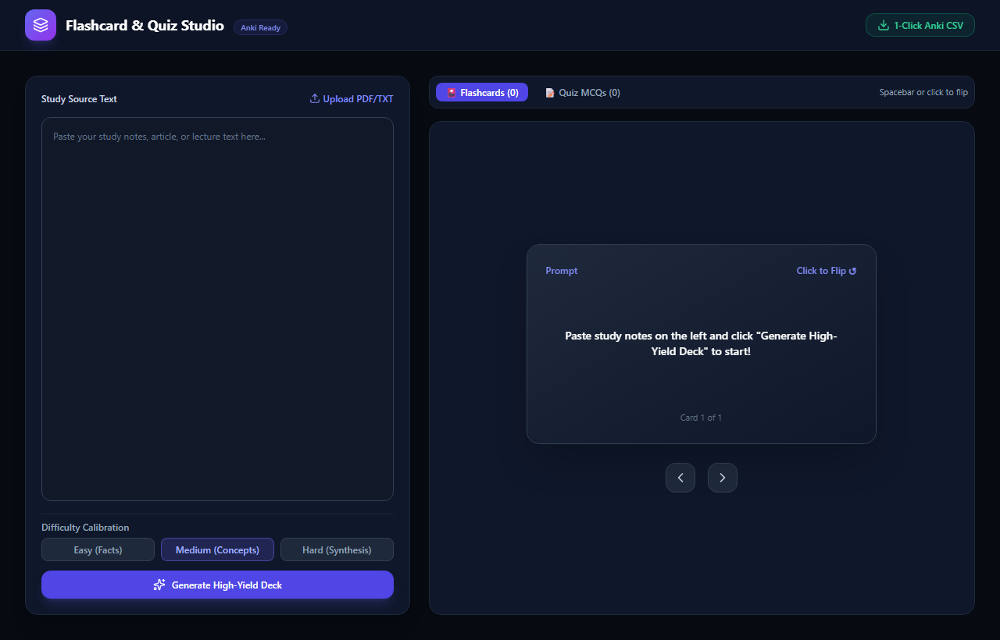

# ⚡ Text to Flashcards & Quiz with Anki Export

Transform study notes, research papers, or uploaded PDFs into active recall flashcards and interactive multiple-choice quizzes with automated deduplication and 1-click Anki export.



---

## ✨ Features
- **Dual Ingestion**: Paste raw text or upload `.pdf`, `.txt`, or `.md` study documents.
- **Active Recall Calibration**:
  - **Easy**: Core definitions and foundational facts.
  - **Medium**: Conceptual mechanics, cause-and-effect, and practical applications.
  - **Hard**: Synthesis, edge cases, trade-offs, and critical reasoning.
- **Deduplication Filter**: Prevents redundant or trivial questions from cluttering study decks.
- **Interactive 3D Flip Card**: Smooth 3D CSS perspective flip with keyboard controls (`Spacebar` to flip, `Left/Right Arrows` to navigate).
- **Interactive Quiz Mode**: Clickable multiple choice questions with immediate correct/incorrect animations and full explanations.
- **1-Click Anki Export**: Generates `#separator:Comma`, `#html:true` formatted CSV files ready for direct import into Anki Desktop and AnkiMobile.

---

## 📦 How & Where to Get Models

This application uses an LLM to extract structured questions and answers:
- **Groq Cloud (Default & Recommended)**: Get a free API key at [console.groq.com](https://console.groq.com/). It uses `llama-3.3-70b-versatile` for fast JSON structuring.
- **OpenAI**: Get an API key at [platform.openai.com](https://platform.openai.com/) and use `gpt-4o-mini`.
- **Offline Mock Engine**: If no API key is provided, the application runs in demonstration mode, generating structured active recall cards instantly.

---

## 🚀 Installation & Setup

### 1. Clone & Navigate
```bash
git clone https://github.com/shamishah0310-hash/flashcards-anki.git
cd flashcards-anki
```

### 2. Install Dependencies
```bash
pip install -r requirements.txt
```

### 3. Configure API Keys (Optional)
Copy `.env.example` to `.env` and add your `GROQ_API_KEY`:
```bash
cp .env.example .env
```

### 4. Run the Studio
```bash
python app.py
```
Open **[http://127.0.0.1:8082](http://127.0.0.1:8082)** in your browser.
